# Ершов Р.Д. Отчёт по лабораторной работе №4 — C++

**Вариант:** 6  
**Класс:** `QuadraticEquation`  
**Дисциплина:** Язык программирования C++

> Полная версия отчёта в формате DOCX: [скачать отчёт](4ЛабС++.docx).

## Содержание
- [Задание 1](#задание-1)
- [Тестирование задания 1](#тестирование-задания-1)
- [Задание 2](#задание-2)
- [Тестирование задания 2](#тестирование-задания-2)

Министерство Образования Российской Федерации

Пермский Государственный Национальный Исследовательский университет

Государственного и муниципального управления

Отчет по Лабораторной работе №4

по дисциплине:

«Язык программирования С++»

Вариант 6.

Выполнил студент гр.ЛА-2, 2 курс

Ершов Р.Д.

Руководитель Ракина В.Д.

г. Пермь, 2026

## Задание 1

### Задача 6

### Текст задачи

Реализовать определение класса (поля, свойства, конструкторы (не менее трех), перегрузку оператора вывода для вывода полей, заданный метод согласно варианту). Протестировать все методы, включая конструкторы, все исходные данные вводятся с клавиатуры, не забывайте проверять данные на корректность.

**Название класса: QuadraticEquation**

**Поля:**

- `double a`
- `double b`
- `double c`
(коэффициенты)

Методы: Вычисление корней квадратного уравнения. Результат должен быть массивом величин типа double (в нем от 0 до 2-х элементов, в зависимости от количества корней).

### Алгоритм решения

Программа работает как меню в бесконечном цикле, пока пользователь не выберет выход.

Вначале создаётся объект equation класса QuadraticEquation конструктором по умолчанию, то есть уравнение x² = 0 с коэффициентами a = 1, b = 0, c = 0. Его текущее состояние сразу выводится на экран с помощью перегруженного оператора <<.

Затем пользователь вводит номер пункта меню от 0 до 7. Ввод проверяется на корректность: значение должно быть числом, целым и лежать в допустимом диапазоне. При ошибке выводится сообщение и запрос повторяется.

Пункты 1–3 проверяют разные конструкторы. Пункт 1 создаёт уравнение по умолчанию. В пункте 2 пользователь вводит три коэффициента a, b и c, а в пункте 3 — два (a и b), при этом c принимается равным нулю.

Каждое введённое значение проверяется на то, что это число, а коэффициент a дополнительно проверяется на неравенство нулю, так как при a = 0 уравнение не является квадратным. После ввода создаётся новый объект и сохраняется как текущее уравнение.

Пункт 4 вызывает конструктор копирования и создаёт копию текущего уравнения.

В пункте 5 пользователь выбирает, какой коэффициент изменить, вводит новое значение, и оно записывается через сеттер (SetA, SetB или SetC).

Пункт 6 выводит текущее уравнение.

В пункте 7 вызывается метод CalculateRoots. Внутри метода вычисляется дискриминант по формуле D = b² − 4ac. Если D < 0, возвращается пустой массив: корней нет. Если D = 0, создаётся массив из одного элемента, и в него записывается x = −b / 2a. Если D > 0, сначала извлекается квадратный корень из дискриминанта по методу Ньютона (так как использовать библиотеки нельзя). Затем создаётся массив из двух элементов, в который записываются x₁ = (−b − √D) / 2a и x₂ = (−b + √D) / 2a. Метод возвращает массив и записывает в параметр rootsCount количество найденных корней. После вывода корней на экран память, выделенная под массив, освобождается оператором delete[].

При выборе пункта 0 цикл заканчивается и программа завершается.

### Тестирование задания 1

**1. Конструктор по умолчанию:**

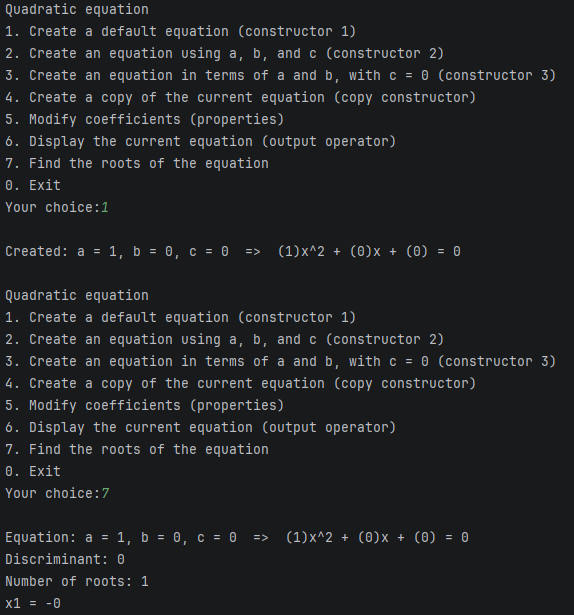

**2. Конструктор с тремя параметрами, два корня:**

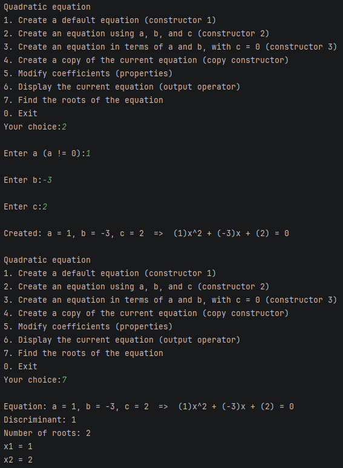

**3. Нет корней:**

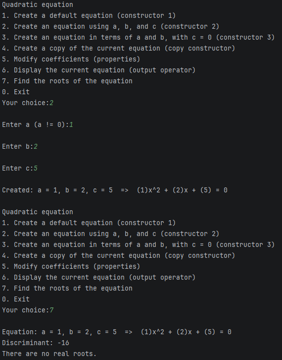

**4. Один корень:**

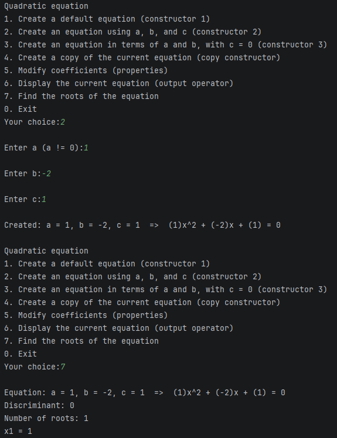

**5. Конструктор с двумя параметрами(с = 0):**

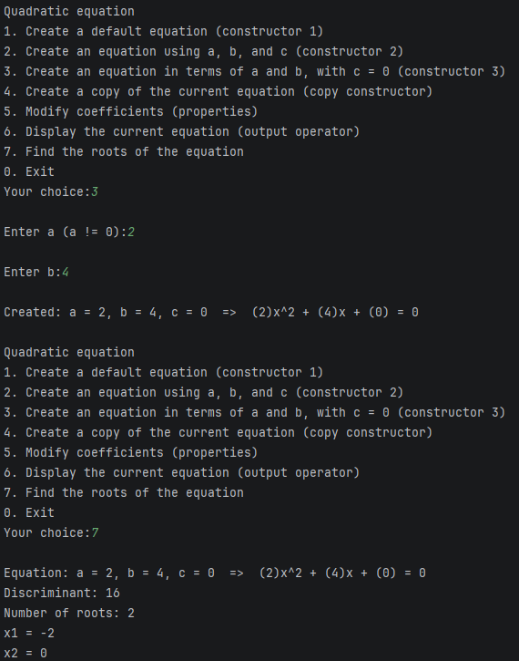

**6. Конструктор копирования:**

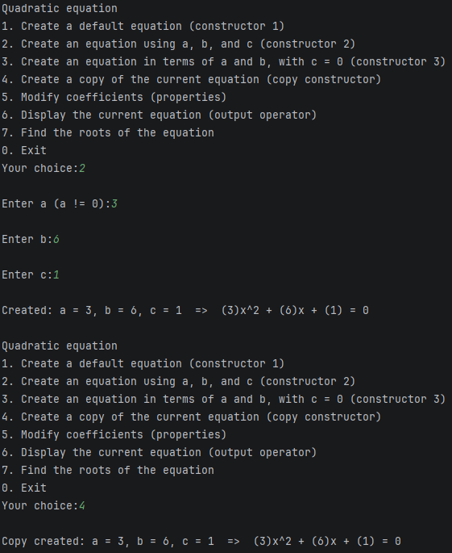

**7. Свойства(сеттеры), оператор вывода:**

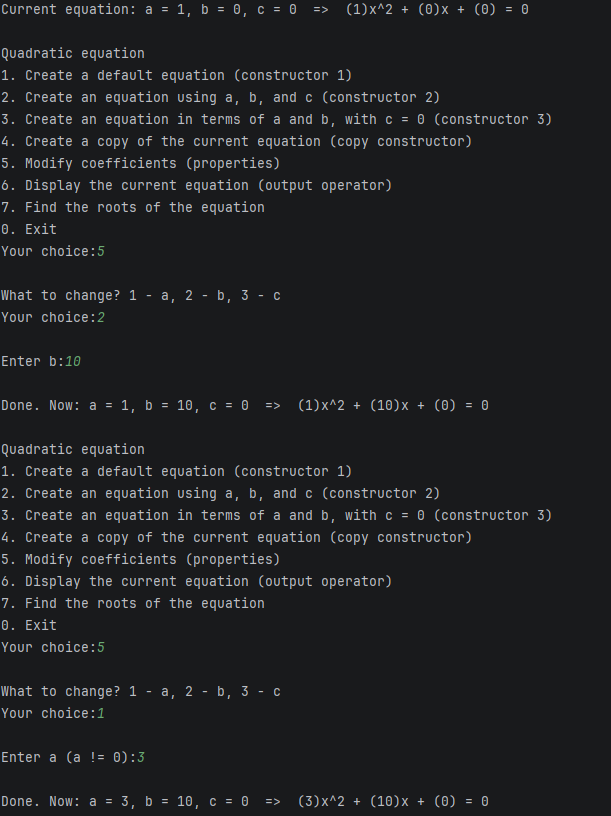

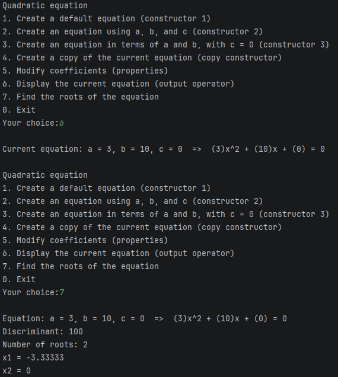

**8. Проверка меню:**

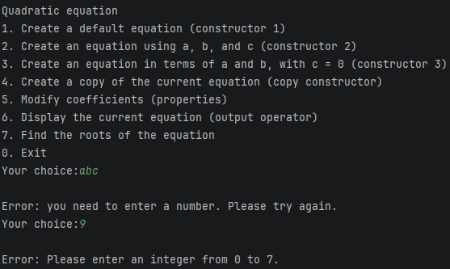

**9. Проверка коэффициента а:**

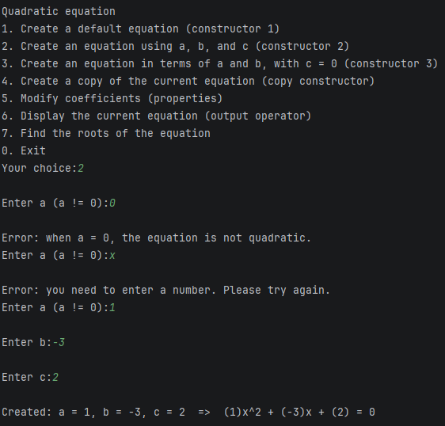

«При а = 0 уравнение не квадратное», «нужно ввести число», затем уравнение создается.

**10. Нечисловой ввод b:**

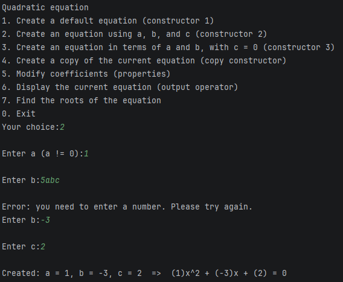

## Задание 2

### Задача 6

### Текст задачи

Добавить к реализованному в первом задании классу указанные в варианте перегруженные операции.

**Название класса: QuadraticEquation**

**Методы:**

Унарные операции: ++ увеличивает коэффициенты уравнения на 1; -- уменьшает коэффициенты уравнения на 1.

Операции приведения типа: double (неявная) – результатом является дискриминант уравнения. bool (явная) – результатом является true, если корни существуют и falseв противном случае; Бинарные операции: == QuadraticEquation t — уравнения равны, если равны их коэффициенты; != QuadraticEquation t — уравнения не равны, если не равны их коэффициенты.

### Алгоритм решения

Программа работает как меню в цикле. При выборе пункта 8 или 9 пользователь выбирает форму операции, префиксную или постфиксную. Перед операцией текущее уравнение копируется, затем вызывается ++ или --, которые прибавляют или вычитают единицу из всех коэффициентов, если a при этом не станет нулём. Если уравнение после операции совпало с сохранённой копией (проверка через ==), выводится сообщение об отклонении операции. При выборе пункта 10 уравнение присваивается переменной типа double, в результате вызывается оператор приведения и возвращается дискриминант. При выборе пункта 11 вызывается static_cast<bool>, который возвращает true для D ≥ 0. При выборе пункта 12 пользователь вводит коэффициенты второго уравнения (a ≠ 0 проверяется), после чего выводятся результаты == и !=.

### Тестирование задания 1

**1. ++х на уравнении по умолчанию:**

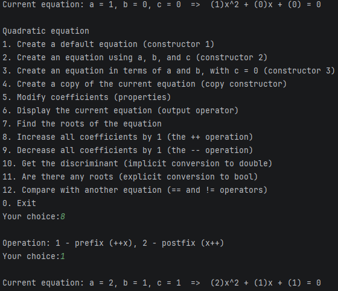

**2. х++ на уравнении по умолчанию:**

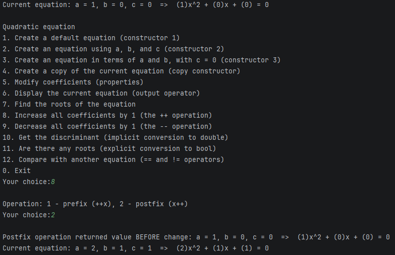

Возвращено старое а = 1, b = 0, c = 0,текущее а = 2, b = 1, c = 1.

**3. --х с отклонением:**

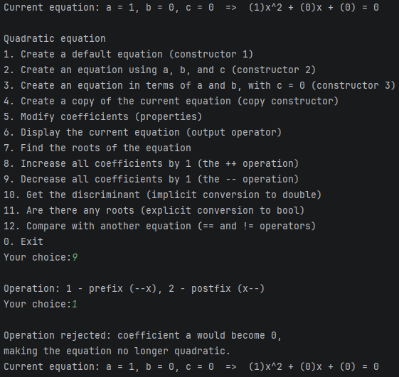

**4. х--на (3, 2, 1):**

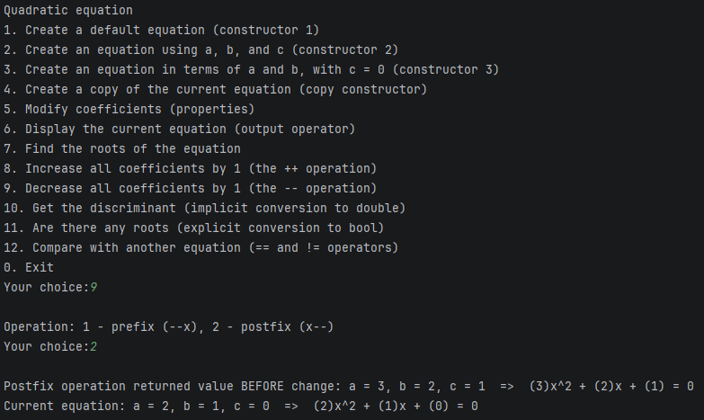

**5. ++ с отклонением при а = -1:**

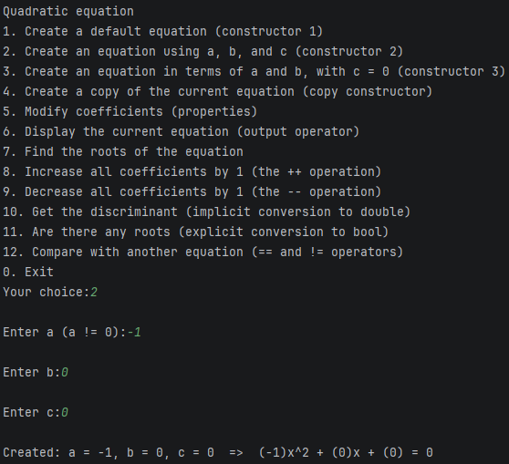

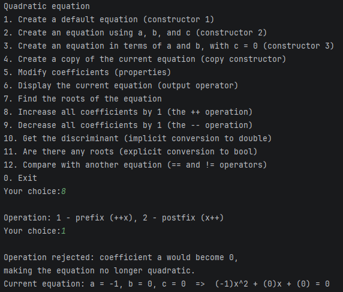

**6. Приведение к double:**

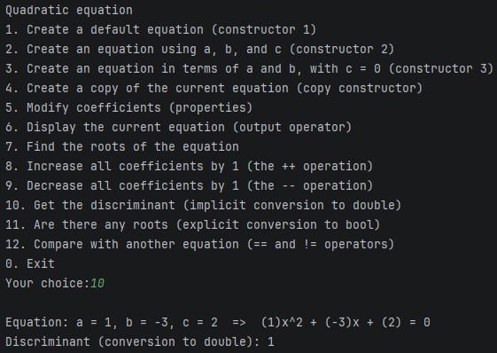

**7. Приведение к bool, корни есть:**

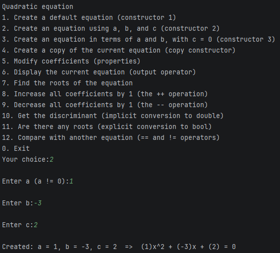

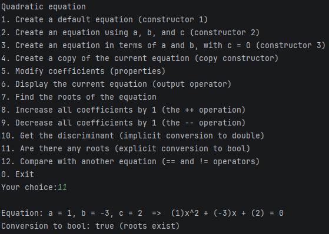

**8. Приведение к bool, корней нет:**

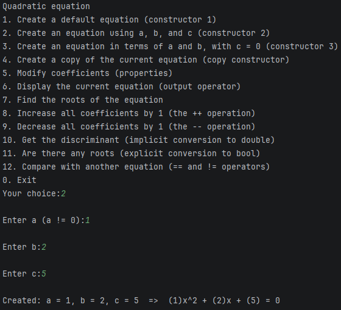

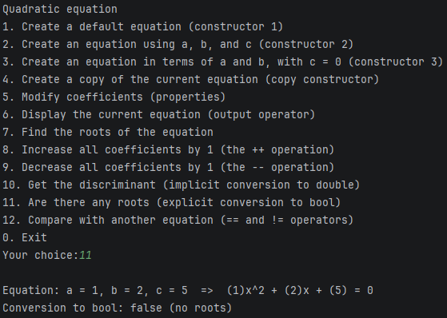

**9. == и !=, равные уравнения:**

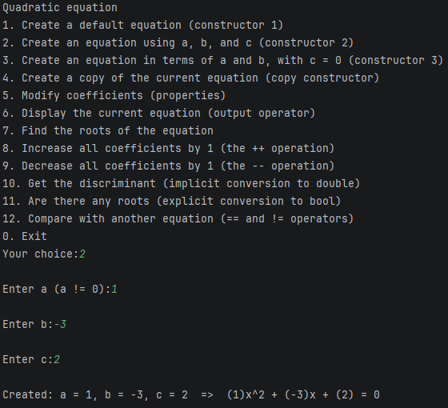

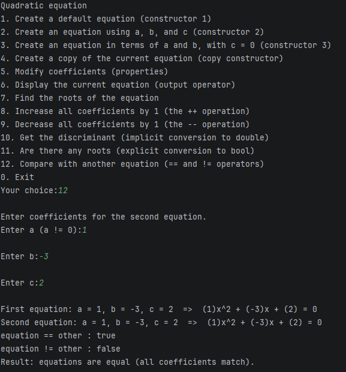

**10. == и !=, разные уравнения:**

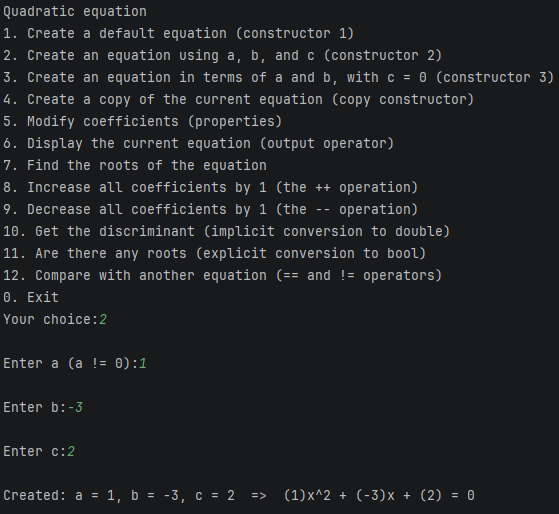

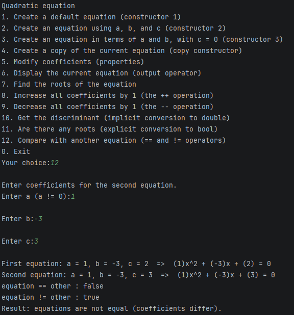
